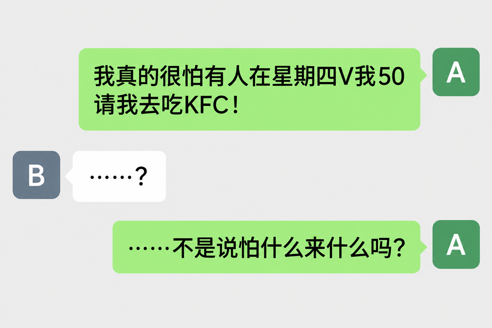
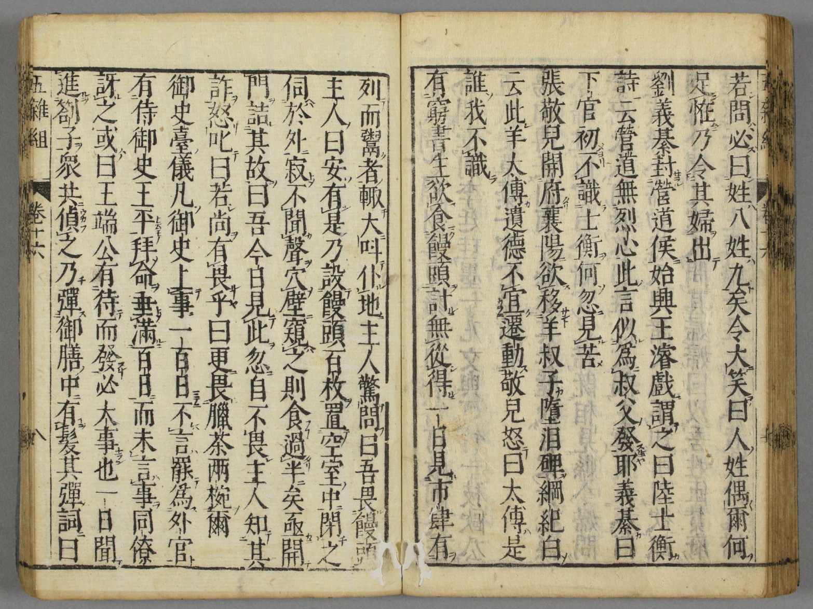


“My greatest fear is someone suddenly sending me 50 yuan!” Think that is just a joke made by today's internet users? As early as the Song dynasty, someone was pretending to be afraid of steamed buns to get a feast. That is the joke of “What you fear is what you get.”

Even more intriguingly, the joke later crossed the sea to Japan and developed into a household classic of rakugo storytelling. How could such a simple joke survive for nearly a thousand years? Join this article in tracing an old joke's remarkable journey.


> Author: silverxz
> Reviewed by: 司徒陌

> A: “I'm really afraid someone will send me 50 yuan on a Thursday to treat me to KFC!”
>
> B: “…?”
>
> A: “…Don't they say that what you fear is what you get?”

You might think that is just a little bit of wordplay, but this particular clever idea has a long history. An almost identical joke appears in **Bishu Luhua** (《避暑录话》), written by Ye Mengde during the Song dynasty.

> If a man studies without taking the examinations, that is one thing. But if he studies and takes the examinations, hopes to pass them, enters office after passing, and seeks advancement through the ranks, none of this is wrong, provided he does not violate the Way or righteousness. Yet there are men who, having entered office and received a salary, loudly proclaim that remaining out of office is nobler, as though they wished to give up their positions. Can this really be what they feel? In fact, they maneuver even more eagerly than those openly seeking office. Some find no opening through which to enter; others make some minor show of disagreement and leave, only to linger afterward. They often acquire a reputation by such means, secure a fine appointment, and accept it without declining, while the world never sees through them. **It is said that a poor scholar who had never known mantou had no way to obtain any. One day, seeing them displayed for sale in a shop, he cried out and fell to the ground. The startled shopkeeper asked what was wrong. “I am afraid of mantou,” he replied. “How can that be?” said the shopkeeper. He put about a hundred buns in an empty room, shut the scholar inside, and quietly watched from outside. Hearing no sound, he made a hole in the wall and peered in: the scholar had already grabbed and eaten more than half of them. The shopkeeper hurriedly opened the door and demanded an explanation. “When I saw them, I suddenly stopped being afraid,” the scholar said. Realizing that he had been deceived, the shopkeeper angrily shouted, “Is there anything else you fear?” “Yes,” replied the scholar. “I am still afraid of two bowls of lacha tea.”** Is this really the sort of man who wishes to remain out of office?

In the joke, a poor scholar unfamiliar with mantou sees them on sale at the market, cries out, falls down, and says, “I'm afraid of mantou.” The seller does not believe him and shuts him in a room with more than a hundred buns, but hears nothing. When he looks inside, more than half the buns have been eaten. Angrily, the seller asks, “Is there anything else you're afraid of?” The scholar replies, “Yes—two bowls of lacha tea.”

The book was written in the fifth year of the Southern Song's Shaoxing era (1135). It is the **earliest** source for this type of joke that I have been able to establish. From the discussion before and after it, we can see that Ye Mengde told the joke to **satirize people who enjoyed high office and generous salaries while pretending they wanted to resign**.

The joke concerns mantou, but remember that Song-dynasty mantou may well have been **meat-filled buns**. Readers may recall the Crossroads Inn in Water Margin: “The fat ones are chopped up for mantou filling; the thin ones are thrown into the river.” Meng Yuanlao's Song-dynasty Dongjing Meng Hua Lu (《东京梦华录》) also mentions “small mutton mantou.”

---

Dynasties changed, but the joke was not lost. In volume sixteen, “Affairs, Part Four,” of **Wu Za Zu** (《五杂组》), completed no later than the forty-third year of the Wanli era (1615), the Ming writer Xie Zhaozhe recorded an almost identical joke. He merely omitted the surrounding commentary and changed a few words:

> A poor scholar wished to eat mantou but could find no way to obtain any. One day, seeing them displayed for sale in a shop, he cried out and fell to the ground. The startled shopkeeper questioned him. “I fear mantou,” he said. “How can that be?” replied the shopkeeper. He put a hundred buns in an empty room, shut the scholar inside, and watched from outside. There was no sound. Peering through a hole in the wall, he saw that more than half had been eaten. He hurriedly opened the door and asked why. “Seeing them today, I suddenly stopped being afraid,” the scholar replied. The shopkeeper knew he had been tricked and shouted angrily, “Do you fear anything else?” “Only two bowls of lacha tea,” came the reply.

Around the same time, the “Mantou” entry in volume twelve of Feng Menglong's **Xiaofu** (《笑府》) recorded the same joke:

> A poor scholar was terribly hungry. Seeing mantou for sale in the market, he pretended to cry out and fall to the ground. The startled shopkeeper asked why. “I am afraid of mantou by nature,” he said. The shopkeeper therefore put several dozen in an empty room and shut the scholar inside, hoping to torment him for a laugh. A long while passed in silence. When the shopkeeper opened the door, he saw that the scholar had grabbed and eaten [more than] half of them. Asked about it, the scholar said, “For some reason, I suddenly no longer feel afraid.” The shopkeeper shouted angrily, “Surely you don't fear anything else?” “Nothing else,” he replied. “At this moment, I fear only two bowls of bitter tea.”

This version makes somewhat more changes in wording. Terribly hungry, a long while in silence, and fear only make the telling a little more theatrical; therefore putting the buns in the room and hoping to torment him for a laugh explicitly supply motives for the characters' actions, strengthening the narrative. For some reason, before “I suddenly no longer feel afraid,” makes the excuse even more absurd. None of these small adjustments changes the plot itself, but they certainly make the wording better suited to the joke as a literary form. Xiaofu is regarded as one of the most important works in the history of Chinese humorous literature, and these choices of words offer us a glimpse of its literary value.

By this point, the joke had secured its place in history. Xiaofu was famous enough that the joke would not disappear even if no other book recorded it. But the story did not end there. Not content with circulating at home, the mantou joke went…**abroad**.

---

In 1661, Wu Za Zu reached Japan, marking the export of the joke itself.

Wu Za Zu, which reached Japan in 1661, and its mantou joke; held by <a href="https://www.wul.waseda.ac.jp/kotenseki/html/i05/i05_01488/index.html">Waseda University Library</a>

Then, in 1662, the sixteenth story in volume three of 曾我休自's 《**為愚痴物語**》, “野間藤六女を誑し餅くふ事” (“野間藤六女誑餅事”—Noma Tōroku Tricks the Women and Eats Rice Cakes) (just kidding), recorded the following story (translated by GPT):

> One day, Noma Tōroku was warming himself by the fire in Lord Jōnosuke's kitchen, together with four or five colleagues, the kitchen maids, and servants doing odd jobs. As they chatted, each began talking about the things they feared.
>
> Someone said, “What frightens me most is a newborn baby mouse!”
>
> Another said, “Nothing is more frightening than snakes, caterpillars, and things like that.”
>
> Yet another said, “Whenever I see pickled plums and plain rice porridge, I think nothing could be more terrifying.”
>
> One after another, they confessed their fears. Only Tōroku sat there saying that he feared nothing at all.
>
> The maids asked him:
>
> “Master Tōroku, what exactly are you afraid of?”
>
> Tōroku replied:
>
> “There is one thing I am especially afraid of. But you must never casually tell other people what you fear. Once they know, they are sure to use it to frighten you. So I absolutely will not say.”
>
> The maids hurried to reassure him:
>
> “Oh, no, no! Who would do something like that to frighten you? Please, do tell us!”
>
> They begged him repeatedly, until he finally agreed:
>
> “In that case, if you promise never to use it to frighten me, I'll tell you.”
>
> He made them swear again and again that they would neither reveal it nor use it against him. Then he lowered his voice and said:
>
> “What I fear most is piping-hot rice cakes, still giving off steam. The moment I see them, my face changes color, my heart pounds, and I may even faint. Once they have cooled down, though, they aren't nearly so frightening.”
>
> The maids exchanged glances. They immediately went to a shop in the street and bought steaming-hot rice cakes, put them in a steamer, and closed the lid tightly.
>
> Then they brought the steamer before Tōroku and said:
>
> “Master Tōroku, please have some refreshments!”
>
> At the sight of it, Tōroku said:
>
> “What I fear most must be in there!”
>
> He began to get up and flee.
>
> But the maids had already crowded around him. They blocked his way, held him fast, brought the steamer right up to his face, and lifted the lid, saying:
>
> “Come on, now! Here are the red-bean rice cakes you're so afraid of!”
>
> As they spoke, they pushed the rice cakes toward his face.
>
> At the sight of them, Tōroku cried out:
>
> “Just as I thought! Oh, how terrifying!”
>
> Still shouting, he squeezed his eyes shut, reached out with both hands, and stuffed the rice cakes into his mouth.
>
> In no time at all, he had eaten every one of the fourteen or fifteen rice cakes!
>
> The maids' enthusiasm for teasing him instantly vanished. Things had turned out quite differently from what they had expected.
>
> They stared in astonishment:
>
> “Master Tōroku, you are a terrible liar! What part of you looks frightened? Not only weren't you afraid—you ate all the rice cakes! What on earth is going on?”
>
> Everyone clapped and burst out laughing.
>
> Only then did Tōroku say:
>
> “No, no, that's not it at all! The sight of such frightening things makes my heart race until I nearly faint. Precisely because they are so terrifying, I have to close my eyes, endure my fear, and eat every last one of them so that they disappear completely. Out of sight, out of mind, after all!”
>
> Then he laughed too.
>
> All the men and women present found this delightful and laughed aloud together.
>
> Later, Tōroku went before Lord Nobutada and recounted the entire affair from beginning to end.
>
> Nobutada also found it highly amusing and praised him:
>
> “Well done! What a clever fellow!”
>
> So impressed was Nobutada by his wit that he rewarded him with a kosode robe.
>
> That, it is said, is how it happened.

Well, that, it is said, is how it happened. As a monogatari, it has clearly become a fuller narrative, with specific characters and a complete plot, while retaining the joke's humorous core. Its details have also been thoroughly localized: mantou become rice cakes, and the poor scholar's final request for tea disappears.

In fact, the changes are substantial enough that I would not confidently claim this story came from Wu Za Zu, and **no historical source directly establishes that connection**. Still, the coincidence of the dates being only one year apart, along with the story's intrinsic interest, persuaded me to keep it here.

Wu Za Zu was not the only route by which the joke could travel abroad. By 1768 at the latest, a handwritten abridged translation of Xiaofu already existed in Japan. Then the joke collections 《**一の富**》 of 1776 and 《**気のくすり**》 of 1779 contained the following two jokes, respectively (translated by GPT):

> “I suppose I was born incompatible with mantou. The moment I see them, I am so frightened that every hair on my body stands on end.”
>
> Several friends who enjoyed practical jokes heard this and found it highly amusing. They shut the man who feared mantou in an empty shop, put freshly steamed buns into a steamer, brought them right under his nose, and clicked the door shut from outside. About one double-hour passed without a sound from within.
>
> “Why is it so quiet? Has he fainted from fright?”
>
> They peered through a crack in the door and saw the man furtively eating mantou. He had already eaten almost all the buns in the steamer.
>
> “The nerve of this fellow! Hey, aren't you afraid?”
>
> The man replied, “Since things have come to this, I'm now afraid of a cup of tea.”

<!-- quote boundary -->

> Four or five people were gathered together when a pale, emaciated man suddenly arrived, panting and trembling all over.
>
> “A mantou seller is coming this way! I'm terribly, terribly afraid of those buns. Please, find somewhere for me to hide!”
>
> They hid him in a storeroom. Then, deciding to play a prank, they bought the buns, piled them on a plate in the shape of a cedar tree, and took them into the storeroom. They shut the door tightly and held it from outside. A long time passed without a sound.
>
> “Could he have died of fright?”
>
> They opened the door and found that every bun had been eaten. The man was still licking his lips.
>
> They asked:
>
> “You were so frightened before that we took the buns in to scare you. But why did you eat them all? What exactly is so frightening?”
>
> He replied:
>
> “Ah, now I'm afraid of two or three cups of tea.”

These two jokes are closer to the versions in Wu Za Zu and Xiaofu. Although there is no direct evidence that they were indeed adapted from Xiaofu, there is one piece of circumstantial evidence: Chinese mantou at the time may well have been meat-filled buns, whereas Japanese manjū were often sweet bean-filled confections. Yet these jokes all chose buns and tea. This could certainly be a coincidence, but borrowing and adaptation are also quite plausible.

The joke subsequently took on new life and is said to have been included in the rakugo collection 《**詞葉の花**》, published in 1797. Rakugo is a Japanese verbal performance art, somewhat like solo xiangsheng, centered on telling humorous stories. Readers may have heard of some rakugo stories: Kenshi Yonezu's song “Shinigami,” for example, comes from the classic rakugo story of the same name, “Shinigami” (“The God of Death”). My favorite version is Tatekawa Shinosuke's, which I recommend listening to.

In short, our mantou joke also became a classic rakugo story, “饅頭怖い” (“Afraid of Manjū”). Its simple plot makes it a frequent feature of children's education, and it is consequently a household story in Japan. It has shed its original satirical intent. Instead of a poor scholar's deception, it is usually playful teasing among friends. Even the buns are no longer the same kind of buns…**but whatever else has changed, the joke itself has survived**.

---

Following the mantou joke's transmission and evolution, we can notice some interesting things:

In Ye Mengde's **Bishu Luhua**, the joke serves a satirical purpose, so after eating the buns, the scholar goes on to ask for lacha tea. The “Fruits, Part Four” section of **Bencao Gangmu** (《本草纲目》) records: “Chen Cheng says: …Today it is also specifically called lacha, supplied as tribute for imperial use.” Chen Cheng was a physician of the late Northern Song. The Yuan-dynasty **Nong Shu** (《农书》) by Wang Zhen says, “Lacha is the most expensive, and its manufacture is no ordinary matter…This product is reserved for tribute and is rarely seen among the people.” It is therefore reasonable to infer that the lacha in Ye Mengde's story was not an ordinary tea either. Perhaps depicting the scholar's greed in this way further served his satirical intention.

The combination of mantou and lacha continued in Wu Za Zu, but in Feng Menglong's Xiaofu it became mantou and bitter tea. What sort of tea was “bitter tea”? Although there is no direct answer, there happens to be an indirect clue. The “Quiet Good Fortune” entry in volume one of Xiaofu records this joke:

> When a ghost was about to be reborn, the King of the Underworld decreed that he should become a rich man. The ghost said, “I do not wish to be rich. I only want enough food and clothing throughout my life, free of disputes and trouble, passing my days burning incense and drinking bitter tea. That would be enough.” The king replied, “If you want silver, I can give you tens of thousands more. But I will not allow you to enjoy that kind of quiet good fortune.”

Clearly, a life of “burning incense and drinking bitter tea” was considered a kind of quiet good fortune. This is enough to show that Feng Menglong's bitter tea was no longer an expensive luxury, but a drink that ordinary people with a stable livelihood could—and would wish to—enjoy.

Why the change? I think **the purpose of the joke itself was changing**. In Feng Menglong's version, it became a joke for its own sake, no longer satirical, so there was no need to portray excessive greed on the scholar's part. Asking for bitter tea was merely a moderate, comical, laugh-provoking bit of “small greed”: he just wanted some tea after his meal.

Later, in the version in 《為愚痴物語》, mantou became rice cakes and the final request for tea was removed. Why? Because in this story, the protagonist was no longer someone to laugh at, but someone to praise. It had become an anecdote about a famous person. Noma Tōroku is a figure of Japan's Sengoku period traditionally known for jokes and witty replies. He is usually described as one of Oda Nobunaga's **otogishū**—a role somewhat like a retained guest or companion. I suspect he may have been a little like Dongfang Shuo. The second request was the key punchline of the original version, yet here it became unimportant, even implausible. After all, Noma Tōroku had no reason to ask the servants for anything. Ending the story with a reward from Oda Nobutada better suited his status.

By the versions in 《一の富》 and 《気のくすり》, these had become thoroughly lighthearted jokes. The requested items returned to buns and tea, but remember that the buns here were small bean-filled sweets, not the meat-filled buns a poor scholar could not afford. The two sides were also more equal: neither the vast disparity in wealth between a poor scholar and a seller nor the gulf in status between Noma Tōroku and the servants remained. This pattern also became established in the later rakugo story.

Although it is the same joke, **small changes in these details subtly change its meaning**. That is what I find so interesting. Whether they really count as the same joke, however, depends on how you understand “what defines the essence of a joke”—a joke version of the **Ship of Theseus** problem. That, too, is an interesting open question.

---

I have found no indication that this joke spread to other Asian countries. If we broaden the definition, however, and look for stories in which someone pretends to be afraid in order to deceive another person and achieve a goal, there are quite a few.

For example, the Persian epic **Shahnameh** (《列王纪》) contains a story that goes roughly as follows:

> The hero Rustam is captured by the demon Div Akvan. The demon asks, “Would you like me to throw you into the sea or onto the mountains?” If he lands in the sea, he may be able to swim to safety; if he is hurled onto a mountain, he will probably die. Rustam knows that the demon likes to act contrary to people's wishes, so he deliberately asks to be thrown onto the mountains.

Another type of story features captured eels, crabs, turtles, and the like pretending to fear water, then escaping when they are thrown into it. There are also stories of rabbits pretending to fear being thrown into a thicket. Such stories are fairly numerous. The “Wang Yao” entry in “Ghosts, Part Ten” of **Taiping Guangji** (《太平广记》) records a story from Shu Yi Ji (《述异记》): “…Yu said to the ghost: Throwing earth and stones at me is nothing I fear; but if you pelt me with money, that will truly put me in difficulty.” In other words, it is a story about tricking a ghost into throwing money at someone so that he can get rich. Similar Korean folktales have also been recorded from elderly storytellers, though much later.

Stories about pretending to fear food in order to get a free meal or drink, however, seem to appear only in China—and Japan, if the Japanese versions were independently created. I have not been able to establish any other examples. Perhaps the stereotype of a people who put food first is not entirely groundless after all (laughs). So if you say, “I'm afraid of suddenly finding a fortune,” that may not be especially original on a global scale. But if you say, “I'm afraid of someone treating me to a meal,” perhaps you can feel quite justified in thinking that you are passing on a form of intangible cultural heritage.

---

As this is an essay intended for enjoyment, I do not plan to add too many cumbersome, detailed citations. Almost all the facts mentioned can be found directly through a search engine. Briefly: the relevant passages from every Chinese classical work mentioned—including Bishu Luhua, Wu Za Zu, Xiaofu, Dongjing Meng Hua Lu, Bencao Gangmu, Nong Shu, and Taiping Guangji—were consulted on the Chinese Text Project website. I found a facsimile of 《為愚痴物語》, but the handwritten Japanese was too difficult to read; the source text actually used came from <https://note.com/raizou5th/n/ne6b8361862f5>. The later passage from 《一の富》 was also taken from that article. For historical material, I also consulted the paper [落語「饅頭こわい」の原話](https://ynu.repo.nii.ac.jp/records/7475).

The source for the existence of a Japanese manuscript copy of Xiaofu by 1768 is the paper [近世日本における中国笑話の受容――『笑府』の抄訳本を中心に――](https://gs.kadai-houbun.jp/engine2/wp-content/uploads/2023/04/project2023.pdf).

The source for 《気のくすり》 and its mantou joke is the paper [海外ジョークの日本における受容](https://www.jstage.jst.go.jp/article/warai/9/0/9_KJ00003259204/_pdf/-char/ja).

A facsimile of the original edition of 《詞葉の花》 is available [here](https://kokusho.nijl.ac.jp/biblio/300050340/1?ln=ja), but…I really cannot read any of it, so I have not directly transcribed or translated its rakugo story in this article.

The source for the Shahnameh story: <https://www.metmuseum.org/art/collection/search/452668>

The source for the stories about fearing water: <https://www.folkloredatabase.com/db_atu.php?atu=1310>

The source for the rabbit stories: <https://sites.pitt.edu/~dash/type0175.html#edwards>

The source for the Korean story: <https://kdp.aks.ac.kr/inde/gubi?id=POKS.GUBI.GUBI.2_123>
