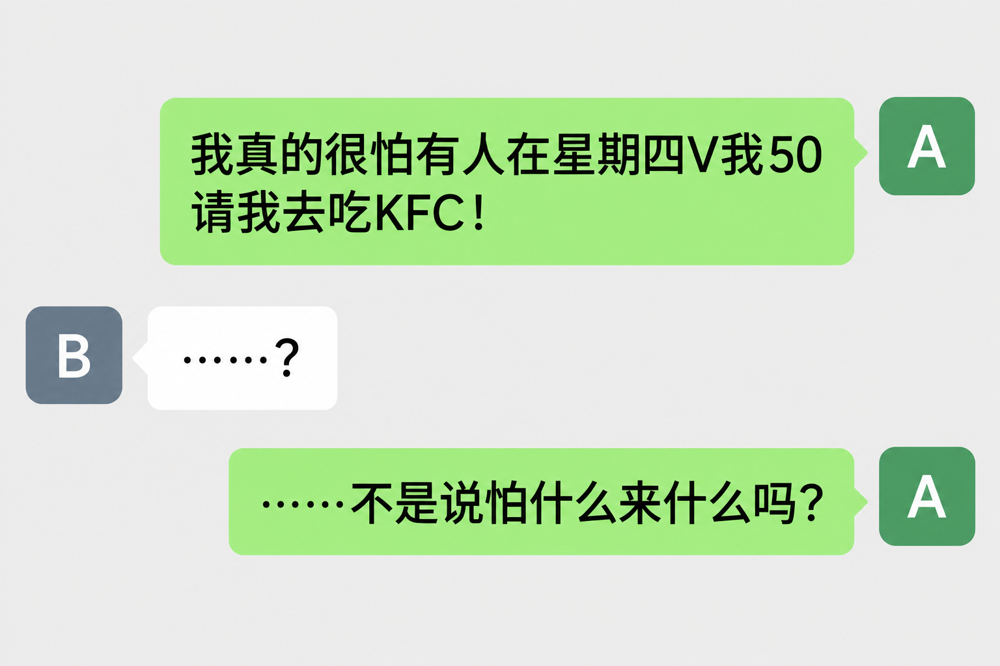
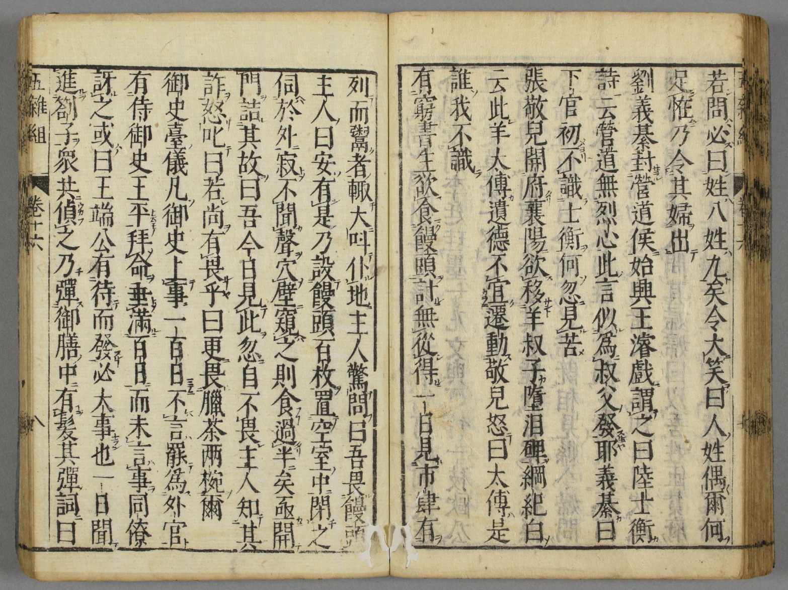


“我最怕别人突然给我转50块钱了！”你以为这只是现代网友的玩笑？其实早在宋朝，就有人靠假装害怕馒头骗来了一顿大餐，这便是“怕什么来什么”的笑话。

更有趣的是，这个笑话后来竟然漂洋过海，传入日本，演变成了家喻户晓的经典落语。一个看似简单的段子，为什么能流传近千年？让本文带你追溯一则古老笑话的奇妙旅行吧。


> 作者：silverxz
> 审核：司徒陌

&emsp;&emsp;或许你觉得这只是一句简单的抖机灵，其实这一“机灵”由来已久。早在宋朝叶梦得所著的《**避暑录话**》中，就有一个几乎相同的笑话。

> &emsp;&emsp;读书而不应举则已矣，读书而应举，应举而望登科，登科而仕，仕而以叙进，茍不违道于义，皆无不可也。而世有一种人，既仕而得禄，反嘐嘐然以不仕为高，若欲弃之者，此岂其情也哉！故其经营有甚于欲仕，或不得间而入，或故为小异以去，因以迟留，往往遂窃名以得美官而不辞，世终不寤也。**有言穷书生不识馒头，计无从得。一日，见市肆有列而鬻者，辄大呼仆地，主人惊问，曰：“吾畏馒头。”主人曰：“安有是理？”乃设馒头百许枚，空室闭之，徐伺于外，寂不闻声，穴壁窥之，则以手搏撮食者过半矣。亟开门诘其然，曰：“吾见此，忽自不畏。”主人知其绐，怒而叱曰：“若尚有畏乎？”曰：“有。犹畏腊茶两碗尔。**”此岂求不仕者也。

<!-- quote boundary -->

&emsp;&emsp;笑话说，有穷书生不识馒头，见集市有卖的，就大叫一声倒在地上，说“我怕馒头”。卖家不信，把他关在有一百多个馒头的屋子里，却听不见动静。等他一看，馒头已经被吃了一多半了。卖家生气：“你还有什么怕的？”书生说：“有，还怕两碗腊茶。”

&emsp;&emsp;此书著于南宋绍兴五年（1135年），是笔者能考证到的这类笑话的**最早**出处。结合前后议论可以看出，叶梦得讲这个笑话，是为了**讽刺那些拿了高官厚禄还假意想要弃官的人**。

&emsp;&emsp;这个笑话说的是馒头，但别忘了，宋代的馒头很可能是**肉馅包子**。读者可能还记得《水浒传》里的十字坡，“肥的切做馒头馅，瘦的却把去填河”。宋代孟元老的《东京梦华录》也载有“羊肉小馒头”这样的说法。

---

&emsp;&emsp;朝代更替，这个笑话却没有失传。明代谢肇淛的《**五杂组**》（最晚成书于万历四十三年，即1615年）的卷十六·事部四记录了一个几乎完全相同的笑话，只是删去了前后的议论，并改变少量用字：

> &emsp;&emsp;有窮書生欲食饅頭，計無從得。一日，見市肆有列而鬻者，輒大叫僕地。主人驚問曰：「吾畏饅頭。」主人曰：「安有是？」乃設饅頭百枚，置空室中，閉之，伺於外，寂不聞聲；穴壁窺之，則食過半矣，亟開門，詰其故。曰：「吾今日見此，忽自不畏。」主人知其詐，怒叱曰：「若尚有畏乎？」曰：「更畏臘茶兩碗爾。」

<!-- quote boundary -->

&emsp;&emsp;同一时期，冯梦龙的《**笑府**》卷十二·馒头，也记载了同一个笑话：

> &emsp;&emsp;有贫士馁甚。见市有鬻馒头者。伪大呼仆地。主人惊问其故。曰吾性畏馒头。主人因设数十枝于空室中。而闭士于内。冀相困以为一笑。久之寂如。乃启门。见其搏食［过］半。诘之。则曰不知何故。忽不觉畏。主人怒叱曰。汝得无尚有他畏乎。曰无他。此际只畏苦茶两碗。

<!-- quote boundary -->

&emsp;&emsp;这个版本的用字变化就又多了一些。馁甚、久之寂如、只畏，让表述稍显戏剧化；因设、冀相困以为一笑则显式填补了人物行为的动机，增强故事性；“忽不觉畏”前的不知何故则进一步强化了理由的荒诞。这些小调整都没有影响故事情节本身，但无疑让表述更适合笑话这种文体。《笑府》被认为是中国笑话文学史上最重要的作品之一，我们也可以凭借此处用字，窥见其文学价值的一二。

&emsp;&emsp;到这里，这个笑话算是在历史上站稳了脚跟——《笑府》足够著名，就算它不再被其他著作载录，也不会失传了。但是，故事没有在这里结束，馒头笑话不满足于在本土流传，竟然……**出国了**。

---

&emsp;&emsp;1661年，《五杂组》流传到了日本，标志着笑话本体的出口。

1661年传至日本的《五杂组》及馒头笑话，藏于<a href="https://www.wul.waseda.ac.jp/kotenseki/html/i05/i05_01488/index.html">早稻田大学图书馆</a>

&emsp;&emsp;而 1662 年，曾我休自的《**為愚痴物語**》卷三第十六的「野間藤六女を誑し餅くふ事」（野間藤六女誑餅事）（bushi）就记载了一个这样的故事（翻译 by GPT）：

> &emsp;&emsp;有一天，野间藤六在城之助殿的厨房里，与四五个同僚，以及厨房里的女佣、打杂的仆役等人一起围着炉火取暖。众人闲谈起来，各自说起自己害怕的东西。
>
> &emsp;&emsp;有人说：「我最怕的就是刚出生的小老鼠了！」
>
> &emsp;&emsp;也有人说：「没有什么比蛇、毛毛虫之类的东西更可怕了。」
>
> &emsp;&emsp;还有人说：「只要看见梅干和白粥，就觉得再没有什么比这更可怕的了。」
>
> &emsp;&emsp;众人就这样纷纷坦白了自己的恐惧。唯独藤六坐在那里，说自己什么都不怕。
>
> &emsp;&emsp;那些女佣便问他：
>
> &emsp;&emsp;「藤六殿，您究竟害怕什么呢？」
>
> &emsp;&emsp;藤六回答：
>
> &emsp;&emsp;「我倒也有一种特别害怕的东西。不过啊，自己害怕的东西，绝不能轻易告诉别人。要是被人知道了，别人一定会拿它来吓唬你。所以我是绝对不会说的。」
>
> &emsp;&emsp;女佣们连忙说道：
>
> &emsp;&emsp;「哎呀，不会不会！怎么会有人做那种吓唬人的事呢？您就一定告诉我们吧！」
>
> &emsp;&emsp;她们一再央求，藤六这才答应：
>
> &emsp;&emsp;「既然如此，只要你们保证绝不拿它来吓唬我，我就告诉你们。」
>
> &emsp;&emsp;他让众人再三发誓，绝不会泄露或者拿来吓唬他，然后压低声音说道：
>
> &emsp;&emsp;「我啊，最害怕的，就是那种热腾腾的、还冒着热气的烫年糕。只要一看见它，我就立刻脸色大变、心跳不止，甚至会昏过去。不过，要是已经凉了，倒也没有那么可怕。」
>
> &emsp;&emsp;女佣们听罢，互相递了个眼色。她们立刻从街上的店铺买来热腾腾、还冒着热气的年糕，装在蒸笼里，把盖子盖得严严实实。
>
> &emsp;&emsp;随后，她们把蒸笼端到藤六面前，说：
>
> &emsp;&emsp;「藤六殿，请用些茶点吧！」
>
> &emsp;&emsp;藤六一见那东西，便说：
>
> &emsp;&emsp;「那里面一定就是我最害怕的东西！」
>
> &emsp;&emsp;说着就要起身逃跑。
>
> &emsp;&emsp;然而，女佣们早已一拥而上，将他拦住，抓住他不放，又把蒸笼凑到他的脸前，揭开盖子，说道：
>
> &emsp;&emsp;「来来来！这就是你最害怕的红豆年糕！」
>
> &emsp;&emsp;说着，把年糕直往藤六脸上送。
>
> &emsp;&emsp;藤六一见，便大叫：
>
> &emsp;&emsp;「果然如此！哎呀，太可怕了！」
>
> &emsp;&emsp;一边叫着，一边紧紧闭上双眼，伸出两只手，抓起年糕就往嘴里塞。
>
> &emsp;&emsp;不过片刻工夫，十四五个年糕竟然全被他吃得干干净净！
>
> &emsp;&emsp;女佣们见状，原本想捉弄他的兴致顿时消散，事情完全出乎她们的意料。
>
> &emsp;&emsp;她们惊讶得目瞪口呆：
>
> &emsp;&emsp;「藤六殿，你可真是个大骗子！你哪里有半点害怕的样子？非但不害怕，竟然还把年糕全都吃光了！这究竟是怎么回事？」
>
> &emsp;&emsp;众人一边拍手，一边大笑起来。
>
> &emsp;&emsp;藤六这才说道：
>
> &emsp;&emsp;「不不，不是那么回事！像这样可怕的东西，我一看见就会心跳不止，几乎昏厥。正因为实在太可怕了，所以我只好闭上眼睛，忍着恐惧，把它们一块不剩地全部吃掉，让它们彻底消失。毕竟，眼不见为净嘛！」
>
> &emsp;&emsp;说完，他自己也笑了起来。
>
> &emsp;&emsp;在场的男女听了，全都觉得妙不可言，一齐放声大笑。
>
> &emsp;&emsp;后来，藤六来到信忠殿面前，把这件事从头到尾、一五一十地禀报了。
>
> &emsp;&emsp;信忠听罢，也觉得十分有趣，称赞他说：
>
> &emsp;&emsp;「干得漂亮！真是个机灵的家伙！」
>
> &emsp;&emsp;因为非常欣赏他的机智，信忠还赏赐了他一件小袖衣裳。
>
> &emsp;&emsp;据说，事情就是这样的。

<!-- quote boundary -->

&emsp;&emsp;嗯，据说，事情就是这样的。作为一则物语，它已经明显故事化了，带有具体的人物和完整的情节，但仍然保留了笑话本身的幽默主干。其具体细节也完全本土化，把馒头变成了年糕，也删掉了穷书生最后索要的茶。

&emsp;&emsp;实际上，这个故事的变化已经大到笔者不敢笃定它来自《五杂组》，**也没有史料直接证明这一点**。不过，时间只差一年的巧合，以及这个故事本身的有趣，还是让笔者把它保留在这儿。

&emsp;&emsp;《五杂组》不是唯一一条出口途径。最晚 1768 年，日本已经有了《笑府》的抄译本。随后，1776 年的笑话集《**一の富**》和 1779 年的笑话集《**気のくすり**》中分别出现了这么两个笑话（翻译 by GPT）：

> &emsp;&emsp;“我大概是天生跟馒头犯冲吧，一看见馒头就怕得不得了，浑身汗毛都竖起来了。”
>
> &emsp;&emsp;有几个喜欢恶作剧的朋友听见了，觉得十分有趣，便把这个怕馒头的男人关进一间空铺子里，又把刚蒸好的馒头装进蒸笼，直送到他鼻子底下，然后从外面咔嗒一声锁上了门。过了约一个时辰，里面一点动静也没有。
>
> &emsp;&emsp;“怎么这么安静？莫不是吓昏过去了？”
>
> &emsp;&emsp;于是从门缝里往里一瞧，只见那个男人正偷偷摸摸地吃着馒头，蒸笼里的馒头已经被他吃得差不多了。
>
> &emsp;&emsp;“这家伙，真是好大的胆子！喂，你不是害怕吗？”
>
> &emsp;&emsp;那男人答道：“既然都这样了，我现在倒是怕起一杯茶来了。”

<!-- quote boundary -->

> &emsp;&emsp;有四五个人正聚在一起，忽然来了一个面黄肌瘦的男人，气喘吁吁，浑身抖个不停。
>
> &emsp;&emsp;“后面有个卖馒头的要过来了！我实在怕那馒头怕得不得了。求求你们，快找个地方让我躲起来吧！”
>
> &emsp;&emsp;众人便把他藏进储物间，又起了恶作剧的心思，买下那些馒头，放在盘子里堆成杉树一般的形状，送进储物间，然后把门关得严严实实，还在外面抵着。过了好久，里面一点动静也没有。
>
> &emsp;&emsp;“莫不是吓死了？”
>
> &emsp;&emsp;众人打开门一看，只见馒头已经被吃得一个不剩，那男人还在舔着嘴唇。
>
> &emsp;&emsp;众人问道：
>
> &emsp;&emsp;“你先前怕成那个样子，我们才拿馒头进去吓唬你。可你怎么全给吃光了？到底哪里可怕了？”
>
> &emsp;&emsp;他答道：
>
> &emsp;&emsp;“唉，如今我又怕起两三杯茶来了。”

<!-- quote boundary -->

&emsp;&emsp;这两个笑话就更接近《五杂组》和《笑府》的版本了。虽然没有直接的证据表明它们确实改编自《笑府》，但有一个侧面证据是：彼时中国的馒头很可能是肉馅包子，而日本的馒头则常是豆馅的甜点，可是这些笑话却都选择了馒头和茶——的确有可能是巧合，但也很可能是借鉴与改编。

&emsp;&emsp;随后，这一笑话焕发新生，据称被收录于 1797 年刊行的落语集《**詞葉の花**》当中。所谓落语，是指日本的一种语言艺术形式，类似于单口相声，以讲述幽默诙谐的故事为主。读者可能也听说过一些落语，比如米津玄师的歌曲《死神》就来自于最经典的同名落语「死神」（笔者最喜欢立川志之辅的版本，推荐读者欣赏）。

&emsp;&emsp;总而言之，我们的馒头笑话也成为了一则经典落语「饅頭怖い」（怕馒头）。其情节简单，常在儿童教育中出现，因而在日本家喻户晓。它脱离了最初的讽刺意，不再是穷书生的欺骗，而通常是朋友之间的打趣玩笑，甚至馒头也不是同一种馒头……**但无论如何，笑话本身确实留了下来**。

---

&emsp;&emsp;沿着馒头笑话的流传与演变史，我们能发现一些有趣的事情：

&emsp;&emsp;在叶梦得《**避暑录话**》的版本中，笑话本身的目的是讽刺，于是书生在吃了馒头之后，又想进一步索要腊茶。——《**本草纲目**》果之四记载“陳承曰：……今亦獨名蠟茶，上供御用”，陈承是北宋末年的医家。元代王祯《**农书**》则称，“蜡茶最贵，而制作亦不凡……此品惟充贡献，民间罕见之”。由此合理推测，叶梦得口中的腊茶也不是什么平常茶品，或许也是借此表现书生的贪心来进一步实现其讽刺意图。

&emsp;&emsp;这一馒头+腊茶的版本在《五杂组》中继续沿用，但到了冯梦龙的《笑府》，就变成了馒头+苦茶。那苦茶又是个什么茶呢？虽然没有直接的答案，但恰好有一个间接的旁证，《笑府》卷一·清福记载了这样一则笑话：

> &emsp;&emsp;一鬼托生时。㝠王判作富人。鬼曰。不愿富也。但愿一生衣食不缺。无是无非。烧香吃苦茶过日。足矣。王曰。要银子便再与你几万。这清福不许你享。

<!-- quote boundary -->

&emsp;&emsp;可见，这“烧香吃苦茶”的日子，被看作是一种清福。这足以说明，冯梦龙笔下的苦茶不再是昂贵的奢侈品，而是稳定生活的普通人也能享受、也愿意享受的饮品。

&emsp;&emsp;为什么会有这种改变？笔者认为，**是笑话本身的目的在发生变化**。在冯梦龙的版本中，它成为了一个纯粹的笑话，不再有讽刺意，于是也不需要表现书生过分的贪婪——索要苦茶仅仅是一种适度的、滑稽的、引人发笑的“小贪婪”，只是想要些饭后的茶罢了。

&emsp;&emsp;再之后，《為愚痴物語》的版本中，馒头变成了年糕，而最后索要茶的桥段被删除了，这又是为什么呢？因为在这个故事中，主人公不再需要被取笑，反而需要被称赞。这变成了一则“名人轶事”——野间藤六是日本战国时代相传以讲笑话、机智应答闻名的人物，通常被介绍为织田信长身边的**御伽众**（含义接近客卿），笔者猜测可能有点像东方朔。所以原始版本的那个二次索要的包袱本来是最关键的笑点，但在这里反倒不重要、甚至不合理了。毕竟，野间藤六没有理由向仆役们索要些什么，于是故事改为以他被织田信忠赏赐结束，更符合其身份。

&emsp;&emsp;等到《一の富》与《気のくすり》中的版本时，它们已经完全是轻松的笑话了。笑话中的索要之物又恢复成了馒头和茶，但别忘了，这里的馒头指的是豆馅的小甜点，而不再是穷书生吃不起的肉馅包子。笑话中的双方也更“平等”，既没有穷书生与卖家在财富上的巨大差异，也没有野间藤六与仆役在身份地位上的巨大差异。这一模式也定型于后来的落语中。

&emsp;&emsp;虽然是同一个笑话，但是**这些细节上的小变化却会导致表意的微妙改变**，这也是笔者觉得很有趣的地方。——不过，它们是否真的算是同一个笑话，这取决于读者如何看待“什么定义了一个笑话的本质”、如何看待笑话版的「**忒休斯之船**」问题。这也是有趣的开放性问题呢。

---

&emsp;&emsp;笔者没有查阅到这个笑话有流传到其他亚洲国家的迹象。不过，如果我们愿意放宽定义，寻找这种“通过假装害怕来欺骗对方，借此达成目的”的故事的话，还是相当多的。

&emsp;&emsp;比如，波斯史诗《**列王纪**》（Shahnameh）中有一个故事，大意是：

> &emsp;&emsp;英雄 Rustam 被恶魔 Div Akvan 抓住。恶魔问他，“你希望我把你扔进大海还是扔到山上？”落入海里还可能游泳逃生，摔到山上却很可能直接丧命。Rustam 知道恶魔喜欢与人作对，于是，他故意请求恶魔把自己扔到山上。

<!-- quote boundary -->

&emsp;&emsp;还有一类故事则是被捉住的鳗鱼、螃蟹、乌龟等假装自己怕水，然后被扔进水里逃走；也有兔子假装自己害怕被丢进树丛里的故事。这样的故事就比较多了。《**太平广记**》鬼十·王瑤还记载过一个出自《述异记》的故事，那里写道，“……庾語鬼。以土石投我，了非所畏，若以錢見擲，此真見困”，也就是一个骗鬼用钱扔他、借此发财的故事。韩国也有根据老人口述记录下来的类似的民间故事，但那是很晚的事情了。

&emsp;&emsp;不过，这种借由怕食物来骗吃骗喝的故事，看起来仅出现在中国（与日本，如果他们是独立创作的话），笔者未能考证到其他材料。看来这种以食为天的刻板印象也不能说是毫无道理（笑）。所以如果读者说“我很害怕突然捡到一笔巨款”，这在世界范围内可能没有新意；但如果说“我很害怕别人请我吃饭”，或许可以很有底气地觉得自己在传播某种非物质文化遗产。

---

&emsp;&emsp;作为一篇有趣的杂文，笔者不打算加太多琐碎繁杂的引用，其中几乎所有事实都可以直接在搜索引擎上找到，简述如下：所有文中提到的中国古籍，包括《避暑录话》、《五杂组》、《笑府》、《东京梦华录》、《本草纲目》、《农书》、《太平广记》等相关内容均参考自网站「中國哲學書電子化計劃」，《為愚痴物語》有找到影印本但手写日文太难读，实际原文参考自<https://note.com/raizou5th/n/ne6b8361862f5>，后面的《一の富》也参考自这一篇。史料部分亦有参考论文 [落語「饅頭こわい」の原話](https://ynu.repo.nii.ac.jp/records/7475)。

&emsp;&emsp;《笑府》在1768年已有传日抄本的信源为论文 [近世日本における中国笑話の受容――『笑府』の抄訳本を中心に――](https://gs.kadai-houbun.jp/engine2/wp-content/uploads/2023/04/project2023.pdf)

&emsp;&emsp;《気のくすり》及其中馒头笑话的信源为论文 [海外ジョークの日本における受容](https://www.jstage.jst.go.jp/article/warai/9/0/9_KJ00003259204/_pdf/-char/ja)

&emsp;&emsp;《詞葉の花》的原刊影印本收录于[此处](https://kokusho.nijl.ac.jp/biblio/300050340/1?ln=ja)，但是……真看不懂一点，所以笔者也没有在原文中直接记录或翻译其中的落语。

&emsp;&emsp;波斯史诗《列王纪》的故事参考自：<https://www.metmuseum.org/art/collection/search/452668>

&emsp;&emsp;怕水的故事参考自：<https://www.folkloredatabase.com/db_atu.php?atu=1310>

&emsp;&emsp;兔子的故事参考自：<https://sites.pitt.edu/~dash/type0175.html#edwards>

&emsp;&emsp;韩国的故事参考自：<https://kdp.aks.ac.kr/inde/gubi?id=POKS.GUBI.GUBI.2_123>

