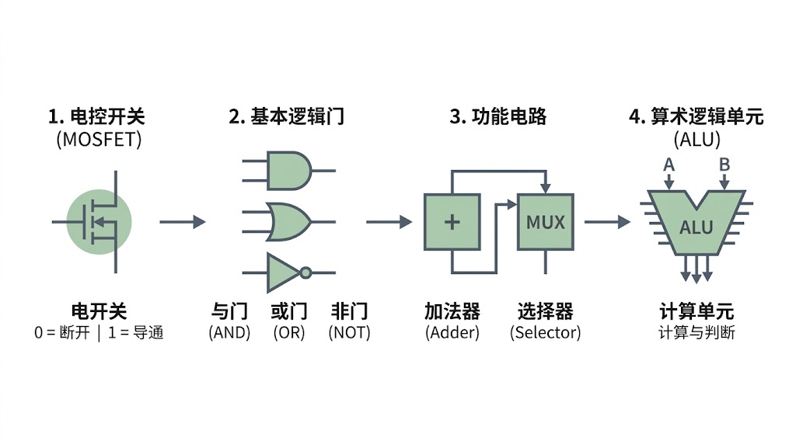
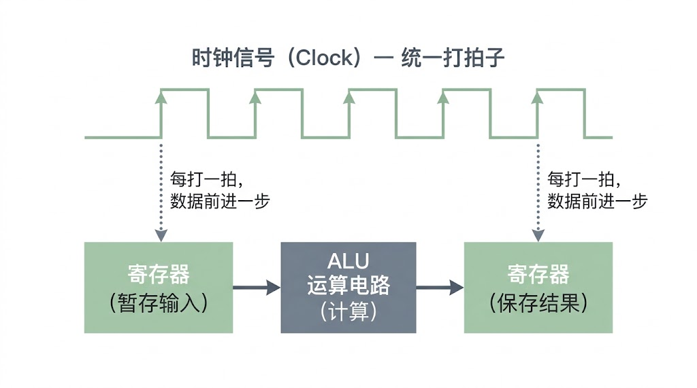
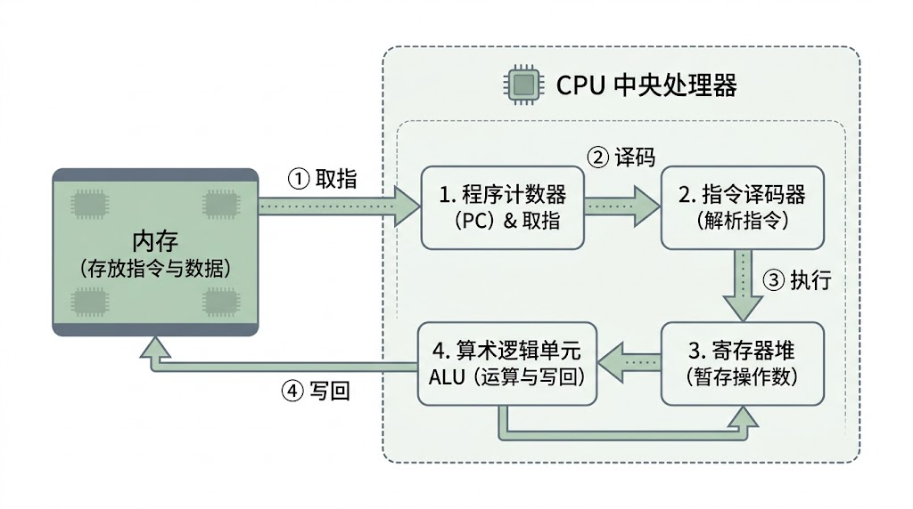


The phones and computers we use every day all depend on a heart—the CPU. How can this tiny electronic component understand instructions, perform calculations, and even run complex games? Let's take a look at the magic behind the CPU.


> Author: emmm
> Reviewed by: 赖渊, **silverxz**

In the introductory installment, we discussed how, whenever you double-click to open a program, calculate the sum of a set of numbers in a spreadsheet, or type a line in a document, the **CPU** is working behind the scenes, following the steps supplied by the software and executing **instructions** one after another.

But if you take a CPU apart and put it under a microscope, all you will find inside are tens of billions of densely packed, tiny circuits. No matter how sharp your eyes are, you cannot directly make out a “calculator” doing the arithmetic or a “notepad” storing the data.

This naturally makes you wonder: how does a collection of metal and silicon with electricity flowing through it learn to “calculate” and “make decisions,” and then run a program step by step? To unravel the mystery, we first need to look at what lies at the very bottom of a chip.

## I. Circuits that can do arithmetic

We normally do arithmetic in **decimal**, but in the world of circuits, trying to distinguish precisely between ten different voltages is far too error-prone—even a little interference could make a “5” look like a “6.” (If we get a chance to discuss signals later, this will become easier to understand; internet connections slow down in places with heavy interference for a similar reason.) The safest approach is to distinguish between just two clearly different states: **a high logic level (electricity present, 1) and a low logic level (no electricity, 0)**.

This is why computers use **binary**. The smallest unit of information, which can represent only “0” or “1,” is called a **bit**. Put many zeros and ones in a row, and they can represent numbers of any size, text, and even program instructions.

Once we have a way to represent numbers, how do circuits process these zeros and ones? The answer lies in a tiny component called a **MOSFET (metal-oxide-semiconductor field-effect transistor)**.

We do not need to delve into its complicated semiconductor physics. (Curious readers can look up doping, but that is beyond the scope of this article.) We only need to think of it as **an automatic switch controlled by voltage**: apply a high logic level to the control terminal, and the switch conducts; apply a low logic level, and it turns off. (In real chips, engineers use pairs of switches together so that the chip leaks almost no current when it is not switching. This is the familiar **CMOS technology**. For understanding the principle, though, the idea of an “electrically controlled switch” is enough.)

A single switch can only determine whether current flows, but cleverly connecting several switches in series or in parallel lets us build **basic logic gates** that follow rules of logic:

**NOT gate**: an input of 1 produces an output of 0, and an input of 0 produces an output of 1. Its job is to output the opposite value.

**AND gate**: the output is 1 only when both inputs are 1. Think of it as “allow passage only when both conditions are met.”

**OR gate**: the output is 1 whenever at least one input is 1. Think of it as “allow passage when either condition is met.”

Binary addition is almost unbelievably simple: 0+0=0 and 0+1=1. The only special case is 1+1, which is written as 10 in binary: the current digit becomes 0, and a 1 is carried to the position on its left. Breaking this down, we only have two things to deal with:

1. **What happens to the carry?**

   Clearly, a carry is produced only when both numbers are 1—exactly what an AND gate already does.

2. **What stays in the current digit?**

   The result is 1 when the two numbers differ and 0 when they are the same. In other words, “at least one must be 1, but they cannot both be 1.” Combine the AND, OR, and NOT gates we just discussed like building blocks, and this logic is easy to construct.

Package together the gates that calculate the current digit and the carry, and you have an **adder**, capable of performing addition.

In actual operation, a CPU needs not only to calculate but also to make choices. For example: “If the result is greater than zero, take path A; otherwise, take path B.” Engineers use a similar approach to build a **selector (Selector / MUX)**. You can picture it as a railway switch: when a control signal arrives, it selects one specified stream from several incoming streams of data and lets it through.

Integrate adders, selectors, and various logic-operation circuits, and the component that does the real work inside a CPU—the **arithmetic logic unit (ALU)**—takes shape.

Figure 1. The construction hierarchy from electrically controlled switches to an arithmetic logic unit (ALU)

## II. How the circuits work together

With an ALU, our circuits can already add numbers and compare values, but that alone is far from enough.

Imagine connecting all the thousands of steps in a complete program into a single circuit network. As soon as the power comes on, current rushes through it at extremely high speed. The result from one step might be overwritten by the next before there is even time to capture it. The circuit simply cannot keep running in an orderly sequence.

At this point, the circuit faces two problems: **where to store the results it has calculated, and what controls the advancement of the data being processed**.

To address these, the chip needs two more essential designs: **registers** and a **clock**.

A register is a CPU core's fastest, closest “scratch pad” for its arithmetic circuits. It uses a special feedback circuit structure to hold the current zeros and ones firmly in place. Whenever the ALU calculates an intermediate result, it first stores that result in a register; when the next step needs it, the result can be read from the register immediately.

At this point, an observant reader might ask: if registers are so fast, why not make more of them? On the one hand, they take up too much space and come with high costs and heat output—storing a single bit often requires more than twenty transistors. On the other hand, if there are too many registers, the wiring needed to select data from them becomes longer, slowing things down instead. This is just a brief indication of the reasons; we will not go into detail here.

So when should a register hold on to the old data, and when should it let new data in?

This calls for a **clock signal** to coordinate everything.

Like the conductor in front of an orchestra, the clock circuit repeatedly sends out alternating high and low electrical pulses, “keeping time” for the whole chip. Here, one “beat” means **one complete clock cycle**: a full rise and fall in the signal level. Whenever the metronome ticks—for example, at the instant the level changes—the registers open their doors in sync, take in and store the results from the previous step, and pass new data to the ALU for the next calculation. **With every beat, the data advances one stage through the circuit**, in an orderly fashion.

Figure 2. How clock signals and registers work together to advance data

Note: The clock signal emits regular pulses like a metronome. With every beat, data advances one stage between the registers and arithmetic circuitry, keeping signals from becoming disorganized.

When you shop for a computer or its components and see a specification such as **5GHz**, it refers to this **clock frequency**: the internal metronome ticks a full **5 billion times per second**! Other things being equal, more beats per second naturally mean more instructions executed and a faster CPU. (You may notice, however, that modern CPUs have made substantial performance gains without dramatic increases in their **clock speed**. This is because the number of instructions a CPU can complete **per beat**, or **IPC**, is equally important. We will discuss that separately later.)

## III. The complete journey of an instruction

Now the ALU that does the arithmetic, the registers that hold the working notes, and the clock that keeps time are all in place. We can finally return to the question left over from the introduction: how exactly does a CPU execute a program instruction? Suppose you set up a simple rule in a spreadsheet: “Add the numbers in cells A and B; if the total is greater than 100, jump to the step that highlights a warning in red.”

By the time the software is running, this rule has already been translated into several ordered **machine instructions**, sitting quietly in **memory**. To avoid losing track of the current step, the CPU has a special register called the **program counter (PC)**. Like a bamboo skewer pointing to a line in a recipe, it always records “where in memory the next instruction to be executed is located.”

As the clock signal advances beat by beat, an instruction goes through four closely connected stages:

**Fetch**: the CPU checks the address indicated by the program counter (PC) and retrieves the current instruction from memory; the PC then automatically points to the location of the next instruction.

**Decode**: the instruction just retrieved is only a code made up of zeros and ones. The **instruction decoder** looks it up in its dictionary and works out what it means—for example, recognizing an “addition instruction” and identifying which registers contain the **operands** it needs.

**Execute**: following the decoding result, the control circuitry opens the relevant paths and sends the two numbers from the registers into the ALU to calculate their sum. If it is the later **conditional jump instruction**—“jump if greater than 100”—the ALU compares two numbers and uses the result to determine whether to change the address in the program counter (PC) directly. **Once the PC has been changed, the CPU will no longer continue in the original sequence at the next step**; it jumps straight to the new instruction that highlights a warning in red.

**Writeback**: the ALU writes the final result back into a specified register (or memory), where it is safely stored.

Figure 3. The core process through which a CPU executes an instruction

Note: The CPU continually cycles through four basic stages—fetch → decode → execute → writeback—processing data through arithmetic operations and implementing conditional decisions and program jumps by changing the program counter (PC).

Link **fetch, decode, execute, and writeback** together, and let the clock signal drive the cycle billions of times every second, and all kinds of complex software, games, and operating systems run smoothly.

However, when we pull back from a single instruction, an awkward problem becomes apparent:

We just saw that, when executing instructions, the CPU needs to fetch instructions and data from memory. The problem is that the CPU's internal clock ticks incredibly fast. From its perspective, data in a register is within arm's reach, while a trip to memory is as slow as crossing half a city to collect goods from a warehouse. If every calculation means waiting for memory to deliver the data, **no matter how fast the CPU can calculate, it spends most of its time standing around doing nothing**.

How does the CPU solve this problem? What role does the **cache** play? Stay tuned for the next installment.
