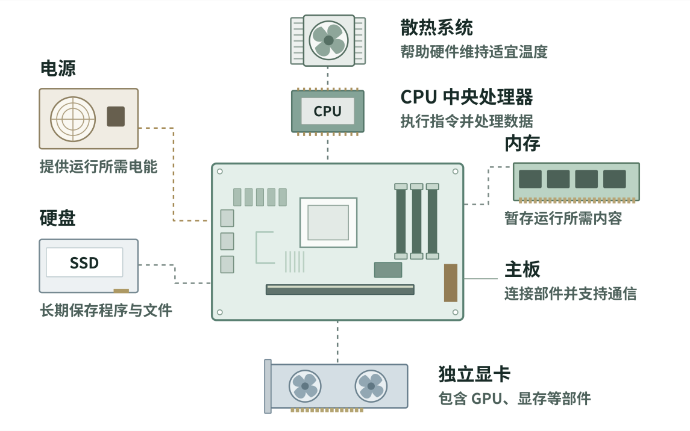


Is pairing a top-tier CPU with a midrange graphics card like making Lü Bu, the legendary warrior, ride a dog? To answer that, we first need to understand what the CPU, memory, storage drive, and graphics card each do in a computer.

From double-clicking to open a program to running a complex game, this article takes you inside a computer to see what determines its performance—and why an expensive configuration does not necessarily make for a better experience.


> Author: emmm
> Reviewed by: 赖渊

Double-click a program icon, wait a moment, and a window appears on your screen. You can then type, play a video, or start a game. Those actions seem simple, but have you ever wondered what happens behind the scenes?

The **CPU, memory, storage drive, and graphics card** are names most of us have heard. We also know they affect a computer's performance. But “affect performance” is still rather vague. To understand a computer, it helps to start with a more concrete question: what does each part do, and how do they work together?

This introduction to the series explains how the main components share the work, so you can get a sense of the computer as a whole. In later articles, we will look at each component in turn: how it works and what its performance specifications actually mean.

You can think of an everyday computer as a system that continually handles **input, processing, storage, and output**. The keyboard and mouse send your actions to the computer, the processor executes the corresponding instructions, storage devices retain information, and the monitor and speakers present the results.

What tells the hardware exactly what to do is **software**. The **operating system** and applications contain large numbers of instructions. The hardware follows them to carry out the functions we see.

Figure 1. Exploded view of the main components of a desktop computer

The dashed lines indicate mounting areas on the motherboard or connections to it. (The power supply and SATA SSD are actually mounted in the case and connected by cables to the motherboard and other components.) Individual power and data cables are omitted, and the drawing is not to scale. This example shows a discrete graphics card, a SATA SSD, and an air cooler for the CPU; actual configurations may differ.

Let's start with the CPU, or **central processing unit**.

The CPU's main job is to **execute program instructions, performing calculations, comparisons, and tests**. Adding a column of numbers in a spreadsheet, processing the text you type in a document, and running part of the logic in a game all involve the CPU.

Think of a program as a set of very specific steps. The CPU follows those steps to process data, then acts on the results. How well it executes instructions and processes data therefore affects how efficiently many tasks can be completed.

Instructions and data need to be kept somewhere before the instructions can be executed. That brings us to another important category of hardware: **devices that store information**. If you are new to computers, start by distinguishing the two kinds you will encounter most often: memory and storage drives.

In everyday use, “memory” generally means **working memory**. It holds the program instructions and data currently needed, so the processor can access them frequently. When you launch an application, the system usually reads what it needs from the drive into memory, then reads more as needed while the application runs.

Working memory is a form of **RAM (random access memory)**. “Random access” means that data in different locations can be accessed by address, without having to read every location in a fixed sequence. “Random” describes the method of access.

The working memory in personal computers commonly uses **DRAM**, or **dynamic random access memory**. It is well suited to frequent reads and writes, but needs power to retain its data. Once power is lost, those data are no longer retained. Anything you need to keep long term must therefore be written to a drive or another storage device.

A drive's job is precisely that: **to keep programs and files long term**.

The software you install, the videos you download, the photos you take, and the documents you save are usually kept on a drive. They remain there even after you shut the computer down normally and disconnect its power. Common types in personal computers include **hard disk drives (HDDs)** and **solid-state drives (SSDs)**. Their internal designs and operating principles differ, but both can store data long term.

Drives belong to what is sometimes called external or secondary storage. “External” does not mean the device has to sit outside the computer case. An SSD installed inside a computer still belongs to this category; USB flash drives and memory cards are also secondary storage devices.

If the drive is a warehouse for your materials, memory is your workbench. The warehouse is good for keeping a large amount of material for a long time; the workbench keeps whatever you are working on within easy reach.

Bringing materials to the workbench does not make the originals in the warehouse disappear. Likewise, reading a file into memory does not normally delete the file on the drive. Changes made during editing must be written back to storage by saving; some applications do this automatically.

> **A closer look: “ROM” and why it is easy to confuse with RAM**
>
> There is another name that is easy to confuse with RAM: **ROM (read-only memory)**.
>
> Traditional ROM holds material written in advance that does not need to be changed during normal use, and retains it when power is off. Whether it can actually be rewritten depends on the storage technology used. The **BIOS/UEFI firmware** in modern computers usually resides in updatable **flash memory** and helps initialize hardware and start the system. It would be wrong to assume that it can never be changed once the computer leaves the factory.
>
> “ROM” in phone specifications is another potentially misleading use of the term. It usually refers to the phone's built-in storage capacity, serving a purpose similar to a computer's drive. What the phone actually uses is flash storage that can be read and written and retains data without power. Common storage solutions include eMMC and UFS. The space for installing apps and saving photos has not somehow turned unwritable read-only memory into writable space; an imprecise name has simply stuck.
>
> We will explore the differences between these storage technologies in later articles. For today, it is enough to know what each one does.

Next comes the **GPU**, or **graphics processing unit**.

Windows, text, images, and game scenes all go through a series of processing steps before they appear on screen. The GPU helps process graphics and generate images, and is particularly good at handling many tasks at once when they lend themselves to parallel computation. In a 3D game, one important job of the GPU is to produce images from information about the scene, materials, and lighting.

A GPU can be integrated into a chip such as the processor, or it can sit on a discrete graphics card. A computer without a discrete card can therefore still use an integrated GPU to display images, play video, and handle everyday office work.

Two terms are often used interchangeably here, but **the GPU is the graphics processor itself**. A discrete graphics card is usually a whole board containing the GPU, video memory, power circuitry, and cooling components.

Alongside the components that handle computation, storage, and graphics, a computer needs **power and cooling systems** to supply energy and keep its hardware at suitable operating temperatures.

The power supply and associated circuitry deliver the electricity each component needs. Components have different power requirements, and stable power is essential for normal operation.

Hardware produces heat as it runs. Heat sinks, fans, and other parts help transfer heat from chips to their surroundings so that the hardware stays at a suitable temperature. If the temperature gets too high, some chips may lower their operating frequency to control heat output, which can also affect performance.

For these components to work together, they need connections provided by the **motherboard**. It is a major circuit board carrying chips, ports, slots, and traces. The CPU, memory, storage devices, and other parts form a system through their respective connections. The motherboard provides electrical connections and communication channels so the components can exchange data. The CPU, GPU, and other controllers work together to carry out the actual tasks.

Once the hardware is connected, how does the computer go from switched off to ready to use? Pressing the power button starts the power-up and boot process. The CPU begins executing code in the BIOS/UEFI firmware mentioned earlier to perform the necessary hardware initialization and checks. A bootloader then loads the operating system.

Once running, the operating system manages memory, files, and devices, and supports applications as they run. The power and cooling systems keep providing the conditions all of this requires.

With the operating system ready, we can return to the everyday task from the beginning: opening a text editor, writing something, and saving it.

When you double-click a program or document icon on the desktop, the mouse first sends the click signal to the system. The system then launches the appropriate application and reads the relevant program instructions and document data from the drive into memory as needed. An application that is already running may simply open the document. The CPU executes the program's instructions and works with the GPU to generate the image of the application window. The monitor displays it, and there is your document.

As you type, every keystroke sets off a sequence of closely coordinated actions. The CPU executes software instructions to process the character you entered, modify the document in memory, and recalculate its layout. The GPU helps generate the updated image, which the monitor then displays. Even one new character on screen is the result of many instructions being executed and many exchanges of data.

When you finish and press “Save” (or the application triggers an autosave), the application saves the modified document to the drive or another storage device so you can use it again next time.

Put these steps together, and it becomes clear why you cannot judge a computer's speed by one component alone. When you open an application, the drive's read speed may affect how long you wait. When several large applications run at once, memory capacity may become the limit. For complex spreadsheet calculations, the CPU may matter more. Exporting a video may involve the CPU, GPU, or dedicated codec units, depending on the software, video format, and settings. In a demanding 3D game, both the speed at which the CPU processes game logic and prepares rendering information and the speed at which the GPU produces frames can affect smoothness. Software optimization and background programs also affect the experience.

So instead of asking broadly, “Is this computer fast?”, first ask what it is doing and which part of the process limits its performance. The same applies when buying a computer: **decide what you want it to do and what results you want, then decide where to spend your budget**.

Take a Ryzen 7 9800X3D paired with an RTX 5070. Some people see a powerful CPU paired with a graphics card that does not measure up, and jokingly call it “Lü Bu riding a dog.” Yet for someone who mainly plays competitive shooters such as *Counter-Strike 2* or *Valorant*, this pairing can make sense. These players are often willing to lower resolution and some quality settings in pursuit of higher, steadier frame rates and more responsive controls.

Lowering settings such as resolution reduces the GPU's workload when producing frames. The CPU, however, still has to run the game logic and prepare the information needed for rendering in time. **Once the CPU is the main limiting factor, a graphics card upgrade may not raise the frame rate much.** If the RTX 5070 already meets the player's needs at the target settings, reserving more of the budget for a CPU with strong gaming performance may be a deliberate choice. Whether the pairing is good value still depends on actual prices and test results for the games in question.

Play differently, and it may make sense to divide the budget differently. If you care more about how demanding 3D games perform at 4K with high quality settings and ray tracing, the load on the GPU usually rises substantially, and upgrading the graphics card first may be more effective. So the answer to “Should I spend more on the CPU or the graphics card for gaming?” depends on the game, resolution, quality settings, and target frame rate. Even within the same genre of shooters, different ways of playing can place very different demands on the hardware.

Even a Ryzen 9 9950X3D paired with an RTX 5090 will not make performance limits disappear. Some scenes put more pressure on the CPU, others on the GPU, and changing a setting can change the limiting factor. Finding that one component is waiting for another is not, by itself, evidence of a poor pairing. The useful comparison is whether a different combination would deliver a better experience for your budget and the way you use the computer. **A balanced configuration allocates performance according to its purpose**; you cannot judge it by model numbers, relative prices, or a quip about Lü Bu riding a dog.

When shopping, start with the software and games you use most. Set targets for resolution, image quality, and frame rate, then look for tests run under similar conditions. For competitive games, look beyond average frame rates: pay attention to frame-rate fluctuations in complex scenes and to how quickly the controls respond. Take your monitor's refresh rate into account when setting a target. Memory, storage, power, and cooling also need to meet the requirements of the system as a whole.

Why do some CPUs have more cores without necessarily running games faster, and why does cache affect gaming performance? To answer those questions, we need to look inside the hardware. In later articles, we will explore specifications such as core count, frequency, and cache. In the [next installment](/en/2026/11/21/computer-hardware-cpu-part-one/), we start with the basic circuits inside a CPU and see how it executes a program instruction.
