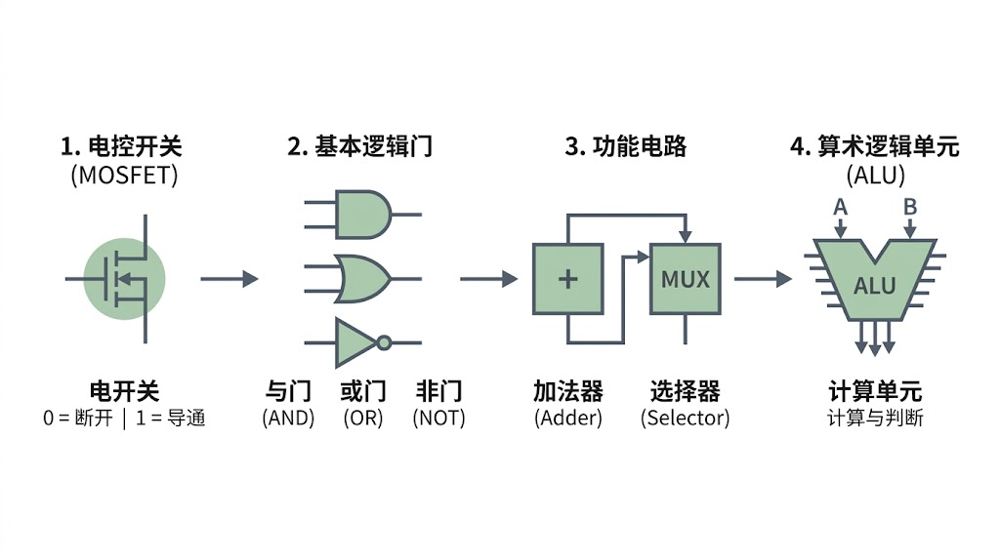
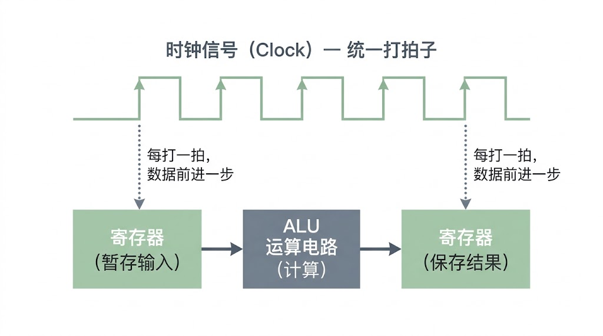
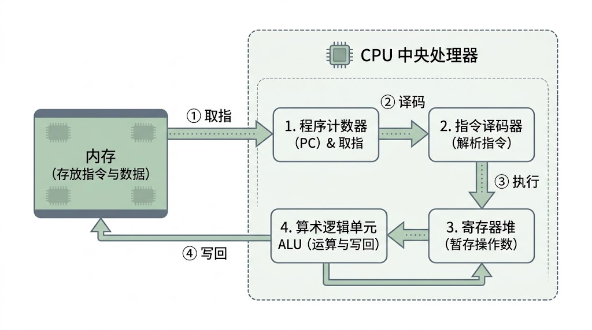


我们日常生活中使用的手机和电脑都离不开一个心脏——CPU。为什么这枚小小的电子元件能够理解指令、进行计算，甚至运行起复杂的游戏？让我们看看 CPU 的背后究竟用了什么魔法吧。


> 作者：emmm
> 审核：赖渊、**silverxz**

&emsp;&emsp;在序篇里我们聊到，当你双击打开软件、在表格里计算一组数字的总和，或者在文档里敲下一行字时，背后都是 **CPU** 在按照软件给出的操作步骤，一条接一条地执行**指令**。

&emsp;&emsp;但如果你把一块 CPU 拆开放在显微镜下，里面只有密密麻麻、数以百亿计的微小电路。在这里，哪怕你注意力再惊人也无法直接看出进行计算的“计算器”以及存数据的“小本本”。

&emsp;&emsp;这不由得让人好奇：一堆通上电的金属和硅片，到底是怎么学会“算数”和“判断”，又是怎么一步步把程序跑起来的？要解开这个谜题，我们可以要先看看芯片最底层长什么样。

## 一、会算账的电路

&emsp;&emsp;我们平时算数习惯用**十进制**，但在电路的世界里，想要精准区分十种不同的电压太容易出错了——稍微受点干扰，数字“5”就可能被误读成“6”（如果后面我们有机会科普到信号的话，你也会更好理解这部分了，干扰大的地方网速慢的原因与此类似）。最稳妥的办法，是只区分两种截然不同的状态：**高电平（有电，1）和低电平（没电，0）**。

&emsp;&emsp;这就是计算机采用**二进制**的原因。一个只能表示“0”或“1”的最小信息单位，就叫做一个**位（Bit，也称比特）**。把许多个“0”和“1”排成一排，就能表示任意大小的数字、文字乃至程序指令。

&emsp;&emsp;有了表示数字的方法，电路又是怎样处理这些 0 和 1 的呢？答案就在一种叫 **MOSFET**（**金属-氧化物-半导体场效应晶体管**）的微小元件里。

&emsp;&emsp;我们不需要深究它复杂的半导体物理细节（读者如果好奇可以去了解下掺杂，但我们的科普不涉及它们），只需要把它看作一个**用电压控制的自动开关**：控制端给高电平，开关就导通；给低电平，开关就断开。（在实际芯片中，工程师会把成对的开关组合起来使用，让芯片在不动作时几乎不漏电，这也就是常说的 **CMOS 技术**。但对我们理解原理来说，抓住“电控开关”就足够了。）

&emsp;&emsp;单个开关只能决定电流通不通，但把几个开关巧妙地串联或并联起来，就能搭出遵循逻辑规则的**基本逻辑门**：

&emsp;&emsp;**非门（NOT）**：输入 1 就输出 0，输入 0 就输出 1，专门负责输出相反值。

&emsp;&emsp;**与门（AND）**：只有两个输入端同时为 1 时，输出才为 1，相当于“两个条件都满足才放行”。

&emsp;&emsp;**或门（OR）**：只要有一个输入端为 1，输出就为 1，相当于“满足任意一个条件就放行”。

&emsp;&emsp;二进制的加法其实简单得不可思议：0+0=0、0+1=1，唯一的特殊情况是 1+1，在二进制里写作 10（本位变成 0，向左边进一位 1）。拆开来看，无非是两件事：

1. **进位怎么办？**

   显然只有当两个数都是 1 时才产生进位——这正好就是一个现成的与门。

2. **本位留什么？**

   两个数不一样时是 1，相同时是 0（也就是“至少有一个是 1，但不能两个都是 1”）。把前面的与门、或门和非门像拼积木一样组合一下，这个逻辑就被轻松搭出来了。

&emsp;&emsp;把算本位和算进位的门电路打包在一起，就诞生了能做加法的**加法器（Adder）**。

&emsp;&emsp;而在实际运行中，CPU 不仅要算数，还要做选择。比如“如果算出来的结果大于零，就走线路 A，否则走线路 B”。这时候，工程师用类似的方法搭出了**选择器（Selector / MUX）**。你可以把它想象成铁路上的“道岔”：来了一个控制信号，它就能在多条输入数据里，挑出指定的一路放行。

&emsp;&emsp;把加法器、选择器以及各种逻辑运算电路整合在一起，CPU 内部真正负责干活的核心部件——**算术逻辑单元（ALU，Arithmetic Logic Unit）**，就正式成型了。

图 1 从电控开关到算术逻辑单元（ALU）的构建层次

## 二、电路具体怎样协作

&emsp;&emsp;有了 ALU，电路已经能算加法、做比较了，但只有它是远远不够的。

&emsp;&emsp;想象一下，如果把一整套程序的几千个步骤全连在一张电路网上，一通电，电流就会以极高的速度一冲到底。上一步刚算出的结果很可能还没来得及看清，就被下一步冲掉了，电路根本没法按顺序持续运行。

&emsp;&emsp;所以这个时候的电路面临两个问题：**一是计算好的结果存储在何处，二是计算的数据由谁来把控推进**。

&emsp;&emsp;为此，芯片里必须补齐另外两样关键设计：**寄存器**和**时钟**。

&emsp;&emsp;寄存器（Register）是 CPU 核心内部速度最快、离运算电路最近的“贴身草稿纸”。它利用特殊的反馈电路结构，能够把当前的 0 和 1 稳稳锁住。每次 ALU 算完一个中间结果，就先存进寄存器里；下一步要用时，瞬间就能从寄存器里读出来。

&emsp;&emsp;这个时候，聪明的读者就会想到了：寄存器速度这么快，为啥我们不多做点呢？一方面这家伙太占地方，并且成本和发热都大——存 1 位数字往往要动用二十多个晶体管；另一方面，寄存器一旦太多，每次从中挑出数据的线路就会变长，反而拖慢了速度，这里就是简单提示，不做细论。

&emsp;&emsp;那么，寄存器什么时候该锁住旧数据、什么时候该放新数据进来呢？

&emsp;&emsp;这就需要**时钟信号**（**Clock**）来统一指挥。

&emsp;&emsp;时钟电路就像交响乐团前的指挥家，周而复始地发出高低交替的电脉冲，给整个芯片“打拍子”。 这里的“一拍”，指的是**一个完整的时钟周期**（电平经历一次上升与下降的完整过程）。每当节拍器敲响一拍（比如在电平跳变的瞬间），寄存器就同步打开一次大门，把上一步算好的结果收进来存好，同时把新数据送进 ALU 进行下一轮计算。**每打一拍，数据就在电路中整齐地向前推进一格**，井然有序。

图 2 时钟信号与寄存器配合推进数据示意

&emsp;&emsp;注：时钟信号像节拍器一样发出规律的脉冲。每打一拍，数据就在寄存器与运算电路之间整齐地向前推进一格，避免信号混乱。

&emsp;&emsp;在你购买电脑或配件的时候，看到的类似 **5GHz** 之类的参数，说的就是这个**时钟频率**——意味着它内部的节拍器每秒钟要敲响整整 **50 亿拍**！在其他条件相同的时候，每秒打的拍子越多，执行的指令自然就越多，CPU 的速度也就越快（不过你或许会发现现代 CPU **主频**的提升幅度并不夸张，性能却在大幅增长，这是因为 CPU **每一拍**能干完多少条指令，即 **IPC**，同样至关重要，我们后面会专门聊到它）。

## 三、一条指令的完整旅程

&emsp;&emsp;现在，算账的 ALU、存草稿的寄存器、打拍子的时钟都已经就位。我们终于可以回到序篇留下的问题：CPU 到底是怎么执行一条程序指令的？不妨假设你在表格软件里设置了一个简单的规则：“把单元格 A 和 B 的数字加起来；如果总和大于 100，就跳去执行标红提醒的步骤。”

&emsp;&emsp;在软件运行时，这段规则早已被翻译成了几条排好队的**机器指令**，安静地躺在**内存**里。为了不搞混当前执行到哪一步了，CPU 内部专门设了一个叫**程序计数器**（**PC，Program Counter**）的特殊寄存器，它就像一根指着菜谱的竹签，永远记录着“下一条要执行的指令在内存的哪个位置”。

&emsp;&emsp;接下来，随着时钟信号一拍一拍地推进，一条指令会经历四个紧密衔接的阶段：

&emsp;&emsp;**取指（Fetch）**：CPU 看一眼程序计数器（PC）指向的地址，去内存里把当前这一条指令取进来；随后 PC 自动指向下一条指令的位置。

&emsp;&emsp;**译码（Decode）**：取回来的指令只是一串 0 和 1 组成的暗号。**指令译码器**负责翻字典，看懂这串暗号的意思——比如认出这是一条“加法指令”，并确认需要用到哪几个寄存器里的**操作数**。

&emsp;&emsp;**执行（Execute）**：控制电路按照译码结果打开通道，把寄存器里的两个数字送进 ALU 算出总和。如果是后面那条“大于 100 就跳转”的**条件跳转指令**，ALU 就会比较两个数的大小，并根据结果决定要不要直接修改程序计数器（PC）里的地址——**一旦修改了 PC，下一步 CPU 就不会按原来的顺序往下走**，而是直接跳去执行“标红提醒”的新指令。

&emsp;&emsp;**写回（Writeback）**：ALU 把算出来的最终结果，写回到指定的寄存器（或内存）里妥善存好。

图 3 CPU 执行一条指令的核心流程

&emsp;&emsp;注：CPU 围绕“取指 → 译码 → 执行 → 写回”四个基本环节不断循环，通过算术运算处理数据，并通过修改程序计数器（PC）实现条件判断与程序跳转。

&emsp;&emsp;把“**取指、译码、执行、写回**”串起来，再由每秒跳动几十亿次的时钟信号不断循环推动，各种复杂的软件、游戏和操作系统就顺畅地跑起来了。

&emsp;&emsp;不过，当我们把目光从单条指令拉远，一个尴尬的事情就会暴露出来：

&emsp;&emsp;刚才我们看到，CPU 执行指令时，需要去内存里取指令、拿数据。偏偏 CPU 内部打拍子的速度实在太快了——在 CPU 眼里，寄存器里的数据伸手就能拿到，而去内存取一趟数据，慢得就像要跨过半个城市去仓库提货。如果每算一步都要干等内存把数据送过来，**哪怕 CPU 算得再快，绝大部分时间也只能停在原地发呆**。

&emsp;&emsp;CPU 究竟是怎么解决这个难题的？**缓存**的作用又是什么？且待下回分解。
