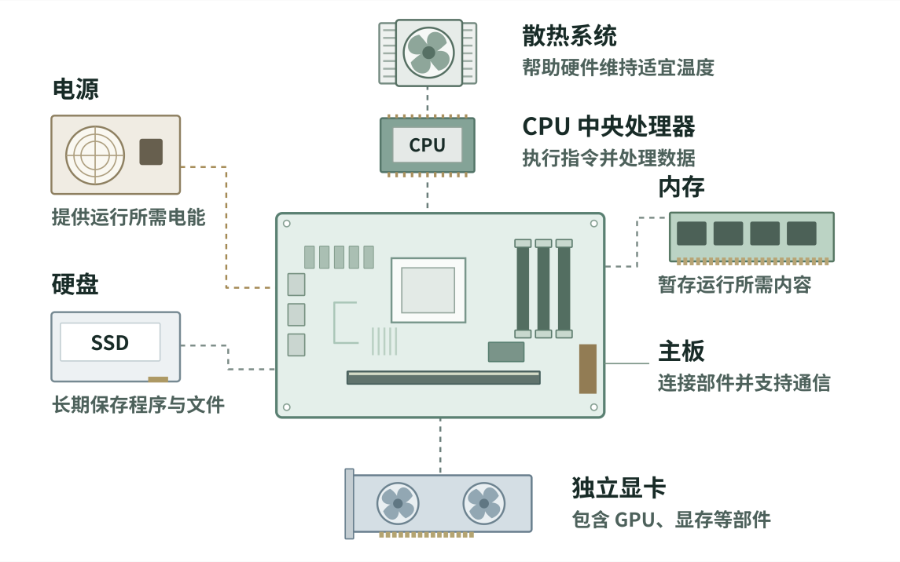


顶级 CPU 搭配中端显卡，就是吕布骑狗吗？要回答这个问题，我们得先搞清楚CPU、内存、硬盘、显卡是如何在电脑中各司其职的。

从双击打开一个软件，到运行复杂的游戏，本文带你认识计算机内部的硬件世界，理解电脑的性能究竟由什么决定，以及为什么昂贵的配置不一定带来更好的体验。


> 作者：emmm
> 审核：赖渊

&emsp;&emsp;当你双击一个程序图标，等待片刻，一个窗口就出现在屏幕上。接着，你可以输入文字、播放视频，或者进入游戏。这些操作看起来很简单，但你是否好奇，这些操作背后到底发生了什么？

&emsp;&emsp;**CPU、内存、硬盘、显卡**……这些名字，我们多少都听说过。我们也知道，它们会影响电脑的性能。不过，“影响性能”仍然是一个比较模糊的说法。要理解一台电脑，可以先从更具体的问题开始：这些部件分别负责什么，又是怎样配合的？

&emsp;&emsp;作为这套科普的序篇，本文会先介绍主要硬件的分工与协作，帮助你建立对整台电脑的基本认识。在后续文章中，我们再逐一深入，看看各个硬件的工作原理，以及常见的性能参数究竟意味着什么。

&emsp;&emsp;我们平时使用的电脑，可以大致看作一套不断进行**输入、处理、存储和输出**的系统。键盘和鼠标把操作传入电脑，处理器执行相应的指令，存储设备保存信息，显示器和音箱把结果呈现出来。

&emsp;&emsp;决定这些硬件具体做什么的，是**软件**。**操作系统**和应用程序包含大量指令，硬件按照这些指令工作，最终完成我们看到的各种功能。

图 1 台式电脑主要硬件的分离示意

&emsp;&emsp;虚线示意各部件在主板上的对应安装区域或连接关系（电源与 SATA SSD 实际固定于机箱内，通过线缆与主板等部件相连），已省略具体供电与数据线缆，非实际比例。以独立显卡、SATA SSD 和 CPU 风冷散热器为例，具体配置可不同。

&emsp;&emsp;先来看 CPU，也就是**中央处理器**（Central Processing Unit）。

&emsp;&emsp;CPU 的主要工作是**执行程序指令，进行计算、比较和判断**。在表格里计算一组数字的总和，编辑文档时处理输入的文字，运行游戏时执行一部分游戏逻辑，都需要 CPU 参与。

&emsp;&emsp;可以把程序理解成一套非常具体的操作步骤。CPU 按照这些步骤处理数据，再根据结果执行后续操作。因此，它执行指令和处理数据的能力，会影响许多任务的完成效率。

&emsp;&emsp;不过，执行指令需要有地方存放指令和数据。这就涉及另一类重要的硬件：**存储器**。对于刚开始了解电脑的读者，我们先分清其中最常见的两种：内存和硬盘。

&emsp;&emsp;日常说的内存，通常指**运行内存**。它用来存放当前运行所需的程序指令和数据，方便处理器频繁访问。启动软件时，系统通常会把需要的内容从硬盘读入内存，并在运行过程中继续按需读取。

&emsp;&emsp;运行内存属于 **RAM**（Random Access Memory，**随机存取存储器**）。“随机存取”指的是可以按地址访问不同位置的数据，不必按照固定顺序逐个读取。这里的“随机”，描述的是访问方式。

&emsp;&emsp;个人电脑常见的运行内存采用 **DRAM**，也就是**动态随机存取存储器**。它适合频繁读写，但需要供电才能维持其中的数据。断电后，这些数据就无法继续保留。因此，需要长期保存的内容，还要写入硬盘等存储设备。

&emsp;&emsp;硬盘承担的，正是**长期保存程序和文件**的任务。

&emsp;&emsp;你安装的软件、下载的视频、拍摄的照片和保存的文档，通常都放在硬盘里。即使正常关机、切断电源，这些内容也能保留下来。个人电脑中常见的硬盘包括**机械硬盘（HDD）**和**固态硬盘（SSD）**。它们的内部结构和工作原理不同，但都可以用来长期存储数据。

&emsp;&emsp;硬盘属于通常所说的外存或辅助存储设备。这里的“外”，并不表示设备一定放在机箱外面。安装在电脑内部的 SSD 同样属于这一类；U 盘和存储卡也属于辅助存储设备。

&emsp;&emsp;如果把硬盘比作储存资料的仓库，内存就像工作台。仓库适合长期存放大量资料，工作台则方便取用和处理眼前的内容。

&emsp;&emsp;把资料拿到工作台上，并不意味着仓库里的原件消失了。同样，把文件读入内存，通常也不会删除硬盘上的文件。编辑过程中产生的修改，需要通过保存写回存储设备；部分软件也会自动完成保存。

> **【延伸辨析：容易与 RAM 混淆的“ROM”】**
>
> &emsp;&emsp;说到这里，还需要认识一个容易与 RAM 混淆的名字：ROM（Read-Only Memory，**只读存储器**）。
>
> &emsp;&emsp;传统的只读存储器用于保存预先写入、在正常使用过程中不需要修改的内容，断电后仍能保留数据。不过，具体能否重新写入，还要看所采用的存储技术。现代电脑的 **BIOS/UEFI 固件**通常保存在可以更新的**闪存**中，负责参与硬件初始化和系统启动等工作，不能简单理解成“出厂后永远无法修改”。
>
> &emsp;&emsp;手机参数中的“ROM”又是另一个容易引起误解的用法。它通常被用来表示机身存储容量，作用类似于电脑里的硬盘，实际使用的是能够读写、断电后保留数据的闪存，常见存储方案包括 eMMC 和 UFS。所以，手机里用于安装应用、保存照片的空间，并不是把不能改写的只读存储器变成了可写空间，而是沿用了一个不够严谨的名称。
>
> &emsp;&emsp;关于这些存储技术的具体区别，我们会在后续专题中展开。我们今天只需要掌握好它们的分工即可。

&emsp;&emsp;接下来是 **GPU**，也就是**图形处理器**（Graphics Processing Unit）。

&emsp;&emsp;屏幕上的窗口、文字、图片和游戏画面，需要经过一系列处理，才能最终显示出来。GPU 会参与图形处理和画面生成，尤其擅长同时处理大量适合并行计算的任务。在三维游戏中，GPU 的重要工作之一，就是根据场景、材质、光照等信息生成画面。

&emsp;&emsp;GPU 可以集成在处理器等芯片中，也可以位于独立显卡上。因此，一台没有独立显卡的电脑，也可能依靠集成 GPU 正常显示画面、播放视频和完成日常办公。

&emsp;&emsp;这里也要区分两个常被混用的概念：**GPU 指图形处理器本身**，独立显卡则通常是一整块包含 GPU、显存、供电和散热部件的硬件。

&emsp;&emsp;除了负责计算、存储和图形处理的部件，电脑还需要**电源和散热系统**，为这些硬件提供电能和适宜的工作温度。

&emsp;&emsp;电源及相关供电电路为各个硬件提供运行所需的电能。不同部件有不同的供电要求，稳定的供电是电脑正常工作的基础。

&emsp;&emsp;硬件运行时会产生热量。散热器、风扇等部件帮助热量从芯片传递到周围环境中，让硬件维持适宜的工作温度。如果温度过高，部分芯片可能降低运行频率，以控制发热，这也可能影响性能。

&emsp;&emsp;要让这些部件协同工作，还需要**主板**提供连接。主板是电脑中一块重要的电路板，上面分布着芯片、接口、插槽和连接线路。CPU、内存、存储设备等通过相应的连接方式组成一个整体。主板提供电气连接和通信通道，使各个部件能够交换数据。具体任务的执行，则由 CPU、GPU 和其他控制器等共同完成。

&emsp;&emsp;硬件连接好之后，接下来是让电脑从关机状态进入可以使用的状态。按下电源键，供电与启动过程随之展开：CPU 开始执行前面提到的 BIOS／UEFI 固件中的程序，完成必要的硬件初始化和检查；随后，通过引导程序加载操作系统。

&emsp;&emsp;操作系统启动后，就会负责管理内存、文件和设备，并为应用程序的运行提供支持。电源和散热系统则持续为这些过程提供运行条件。

&emsp;&emsp;等操作系统启动完成，我们就可以回到开头提到的日常操作：打开文字编辑软件，写点东西，再保存下来。

&emsp;&emsp;当你双击桌面上软件或文档的图标时，鼠标先把这个点击信号传给系统。接着，系统启动相应的软件，并按需把相关的程序指令和文档数据从硬盘读入内存；已经在运行的软件，也可能直接打开这份文档。CPU 执行程序指令，配合 GPU 生成软件窗口的画面，再交给显示器呈现出来，这时，文档就在你眼前打开了。

&emsp;&emsp;随后你敲击键盘输入文字，每一次按键都会触发一连串紧密的配合：CPU 执行软件指令，处理输入的字符、修改内存里的文档内容并重新计算排版，GPU 参与生成更新后的画面，再由显示器呈现出来。所以，哪怕只是屏幕上多出一个字，背后其实已经完成了许多次指令执行和数据交换。

&emsp;&emsp;等你写完按下“保存”（或者软件触发自动保存），软件会将修改后的文档内容保存到硬盘等存储设备中，方便下次继续使用。

&emsp;&emsp;把这个过程串起来看，就很容易明白为什么电脑的快慢不能只看某一个部件了。打开软件时，硬盘的读取速度可能影响等待时间；同时运行多个大型软件时，内存容量可能成为限制；处理复杂的表格计算时，CPU 的能力可能更关键。视频导出则可能同时涉及 CPU、GPU 或专门的编解码单元，具体取决于软件、视频格式和设置。运行大型三维游戏时，CPU 处理游戏逻辑和准备绘制信息的速度，以及 GPU 生成画面的速度，都可能影响流畅度。软件的优化和后台程序也会影响体验。

&emsp;&emsp;因此，与其笼统地问“这台电脑快不快”，不如先看它正在干什么活儿，又是哪个环节限制了它的表现。选购电脑也是如此：**先想清楚自己要用它完成什么任务、希望达到怎样的效果，再决定把预算花在哪里**。

&emsp;&emsp;比如，看到 Ryzen 7 9800X3D 搭配 RTX 5070，有人会觉得 CPU 选得很强，显卡却没跟上，戏称这是“吕布骑狗”。但对于主要玩《反恐精英 2》《无畏契约》等竞技射击游戏的人，这种搭配完全可能有它的道理。这类玩家往往愿意降低分辨率和部分画质，追求更高、更稳定的帧率，以及更及时的操作响应。

&emsp;&emsp;降低分辨率等设置，会减轻 GPU 生成画面的负担；但 CPU 仍需要及时完成游戏逻辑计算、准备绘制所需的信息。**当主要限制已经落在 CPU 一侧时，继续升级显卡，帧率也未必能明显提高**。如果 RTX 5070 在目标设置下已经能够满足需求，那么把更多预算留给游戏性能较强的 CPU，就可能是有针对性的选择。至于这套搭配是否划算，还需要结合实际价格和目标游戏的测试结果来判断。

&emsp;&emsp;换一种玩法，预算的分配就可能不同。如果你更在意大型三维游戏在 4K 分辨率、高画质和光线追踪下的表现，GPU 的负担通常会明显增加，优先升级显卡便可能更有效。所以，“玩游戏应该多花钱买 CPU，还是多花钱买显卡”，需要结合具体游戏、分辨率、画质和目标帧率来回答。即使同样是射击游戏，不同玩法对硬件的要求也可能相差很大。

&emsp;&emsp;即便换成 Ryzen 9 9950X3D 搭配 RTX 5090，也不会让性能限制从此消失：有的场景更考验 CPU，有的场景更考验 GPU，换一个设置，限制因素还可能改变。发现某个部件在等待另一个部件，并不足以说明这套配置搭错了。真正值得比较的是，在自己的预算和使用条件下，换一种搭配，能不能获得更好的实际体验。**合理的配置，应当围绕用途分配性能**，不能只凭型号、价格比例，或者一句“吕布骑狗”来判断。

&emsp;&emsp;落到实际选购时，我们可以先确定常用的软件和游戏，再明确分辨率、画质、帧率等目标，参考接近这些条件的实测结果。对于竞技游戏，除了平均帧率，也要留意复杂场景中的帧率波动和操作响应，并结合显示器的刷新率来确定目标。内存、硬盘、电源和散热等部件，也要满足整机正常运行的需要。

&emsp;&emsp;至于为什么有的 CPU 核心更多，游戏却未必跑得更快，为什么缓存也会影响游戏表现，就需要进一步了解硬件内部的工作方式了。后续文章中，我们会逐步讨论核心数、频率和缓存这些参数。[下一篇](/2026/11/21/计算机硬件科普%20CPU（一）/)，就先从 CPU 内部的基本电路聊起，看看它究竟怎样执行一条程序指令。
